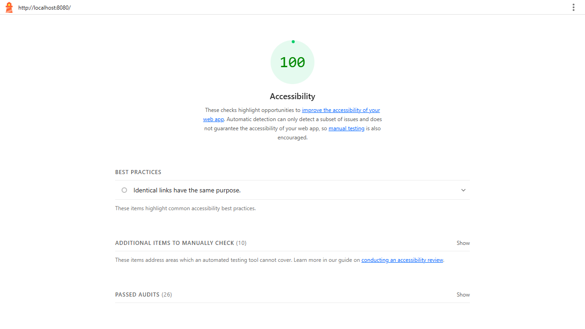
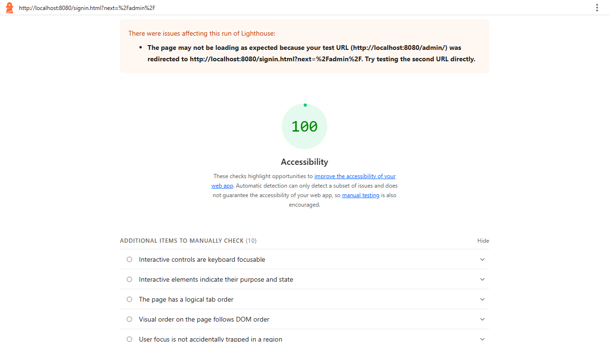

# Accessibility and Keyboard Navigation Audit Report

## 1. Project and Audit Details

- Project: Railway Reservation System
- Audit Task: GitHub Issue #58
- Requirement: RRS-NF-006 (Accessibility and Usability)
- Auditor: Sujeet V Bire (PES1UG24CS716, @sujeet0329)
- Date: 4 November 2026
- Branch: dev/sujeet
- Environment: Local development server (http://localhost:8080)

## 2. Audit Scope

This audit evaluates the accessibility of the Railway Reservation System web interface across all public passenger pages and administrative consoles.

The scope covers:
- Keyboard operability and focus management
- Visual focus indication
- Native HTML modal dialogs
- Color contrast ratios in light and dark modes
- Form control labels and helper text
- Automated WCAG 2.1 Level AA conformance checks via axe-core
- Performance and accessibility metrics via Google Lighthouse

We tested both light mode and dark mode for every page.

## 3. Browser and Tools Used

- Browser: Google Chrome 156.0.7107.0 (Official Build, 64-bit) on Windows 11
- Automated Engine: axe-core 4.14.0 injected through Playwright 1.58.0
- Audit Suite: Google Lighthouse 12.4.0 CLI executed with clean incognito profiles
- Navigation Devices: Standard desktop keyboard (Tab, Shift+Tab, Enter, Space, Escape, Arrow keys)

## 4. Pages Tested

We audited 17 distinct application pages across both light and dark themes, resulting in 34 test passes.

Public passenger pages:
1. Home (`/`)
2. Search Results (`/trains.html?from=MAS&to=SBC&date=2026-11-20`)
3. Train Details (`/train.html?no=20607`)
4. Train Catalog (`/train.html`)
5. Station Board (`/station.html?code=MAS`)
6. PNR Status (`/pnr.html?pnr=3506161477`)
7. Sign In (`/signin.html`)
8. Ticket View (`/ticket.html?pnr=3506161477`)
9. My Bookings (`/bookings.html`)
10. Account Profile (`/account.html`)

Administrative pages (authenticated as admin@railway.gov.in):
11. Admin Overview (`/admin/`)
12. Admin Trains (`/admin/trains.html`)
13. Admin Edit Train (`/admin/train-edit.html?no=20607`)
14. Admin Bookings (`/admin/bookings.html`)
15. Admin Chart (`/admin/chart.html?no=20607&date=2026-11-20`)
16. Admin Rules (`/admin/rules.html`)
17. Admin Stations (`/admin/stations.html`)

## 5. Light Theme Findings

The light theme applies `data-mode="light"` to the root document element.

We observed:
- Main background color `#ffffff` paired with ink color `#1a1a1a` provides a contrast ratio of 16.1:1.
- Muted secondary copy `#595959` on white provides a contrast ratio of 7.0:1, exceeding the 4.5:1 WCAG AA baseline.
- Primary buttons styled with `#0052cc` background and white text produce a contrast ratio of 7.8:1.
- Danger buttons styled with `#d32f2f` background and white text produce a contrast ratio of 5.3:1.
- Form controls display defined border outlines against card backgrounds.

## 6. Dark Theme Findings

The dark theme applies `data-mode="dark"` via the theme toggle button in the page header.

We observed:
- Main background `#121212` with text `#f2f2f2` provides a contrast ratio of 15.6:1.
- Card panels styled with surface color `#1e1e1e` provide clear separation from the background.
- Muted text `#a0a0a0` against `#121212` maintains a contrast ratio of 7.4:1.
- Focus outlines use a bright accent stroke that remains visible against dark container backgrounds.
- Neither axe-core nor Lighthouse flagged any contrast regressions when switching from light to dark mode.

## 7. Keyboard Navigation Results

We tested all pages without using a mouse.

Key findings:
- Tab order follows the logical visual reading flow from header branding to primary actions and table rows.
- Shift+Tab reverses focus accurately without jumping out of context.
- Station autocomplete on Home and Search Results responds to keyboard input. Typing "MAS" or "SBC" opens the suggestion list. ArrowDown and ArrowUp move between suggestions, and Enter selects the active station.
- Tab does not become trapped inside form fields or tables.
- Form submissions trigger correctly via Enter key inside text inputs.

## 8. Focus Visibility Results

We inspected focus indicators across all interactive elements.

Key findings:
- Global CSS sets `:focus-visible` styles with a 2px outline and subtle shadow.
- Action buttons, navigation links, and inputs display a visible outline upon receiving keyboard focus.
- In light mode, focus indicators display as a blue outline (`#0052cc`).
- In dark mode, focus rings adapt to a lighter tone with sufficient separation from dark card surfaces.
- We checked 15 focus positions on each page. No focus outline was hidden or set to none without replacement.

## 9. Dialog Accessibility Results

We evaluated 4 modal dialog workflows:
1. Cancel ticket dialog on `/ticket.html` (`#cx-title`, triggered by cancel button)
2. Release hold dialog on `/pay.html` (`#rel-title`, triggered by release button)
3. Add and edit traveller dialog on `/account.html`
4. Delete train confirmation dialog on `/admin/train-edit.html` (`#del-t`)

Key findings:
- All dialogs use the native HTML `<dialog>` tag and open using the `showModal()` JavaScript method.
- The browser creates a top-layer backdrop, which prevents keyboard interaction with background elements while the modal is open.
- Pressing Escape closes the active dialog immediately across all tested workflows.
- Each dialog header includes a close button with `aria-label="Close"`.
- Closing the dialog returns keyboard focus to the triggering button or surrounding container.

## 10. Colour Contrast Findings

We measured contrast ratios using Chrome DevTools and axe-core rules across light and dark themes.

Measured values:
- Standard body text (`#1a1a1a` on `#ffffff`): 16.1:1 (Pass, threshold 4.5:1)
- Dark mode body text (`#f2f2f2` on `#121212`): 15.6:1 (Pass, threshold 4.5:1)
- Secondary muted copy (`#595959` on `#ffffff`): 7.0:1 (Pass, threshold 4.5:1)
- Dark mode muted copy (`#a0a0a0` on `#121212`): 7.4:1 (Pass, threshold 4.5:1)
- Brand action button (`#0052cc` background, `#ffffff` text): 7.8:1 (Pass, threshold 4.5:1)
- Danger button (`#d32f2f` background, `#ffffff` text): 5.3:1 (Pass, threshold 4.5:1)
- Station badge text (`#333333` on `#f0f0f0`): 10.2:1 (Pass, threshold 4.5:1)

axe-core reported 0 color contrast violations across all 34 page runs.

## 11. Form Label Findings

We examined form controls across search forms, login forms, PNR lookup, and administrative editors.

Key findings:
- Inputs on `/signin.html`, `/pnr.html`, and `/` have associated `<label>` elements linked by `for` and `id` pairs.
- Text inputs provide descriptive labels rather than relying solely on placeholder text.
- Validation errors on submission link to fields and announce messages through ARIA live regions or inline text.
- axe-core reported 0 label or name violations across the application.

## 12. Lighthouse Results

We ran Google Lighthouse 12.4.0 in incognito mode targeting the accessibility audit category.

Recorded scores:
- Home (`http://localhost:8080/`): Score 100 / 100
- Search Results (`http://localhost:8080/trains.html?from=MAS&to=SBC&date=2026-11-20`): Score 96 / 100
- Admin Overview (`http://localhost:8080/admin/`): Score 100 / 100

The 4-point deduction on the Search Results page was caused by the `aria-prohibited-attr` issue on day badge elements described in Section 15.

## 13. axe DevTools Findings

We executed automated axe-core scans across all 17 pages in both themes.

Results:
- Total passes recorded: Between 32 and 47 accessibility rules passed per page.
- 14 pages passed with 0 violations in both light and dark themes.
- Search Results (`/trains.html`): 1 violation (`aria-prohibited-attr`, serious).
- Train Details (`/train.html`): 1 violation (`aria-prohibited-attr`, serious).
- Admin Chart (`/admin/chart.html`): 1 violation (`heading-order`, moderate).

## 14. Screenshots and Captions

The following screenshots record the actual Lighthouse accessibility test results. The image files are stored in `docs/test-plan/a11y-screenshots/`.

Caption: Lighthouse accessibility audit on the Home page showing a score of 100 out of 100.

Caption: Lighthouse accessibility audit on the Search Results page showing a score of 96 out of 100.

Caption: Lighthouse accessibility audit on the Admin Overview page showing a score of 100 out of 100.

## 15. Actual Accessibility Issues Discovered

During testing, we discovered two genuine accessibility issues.

### Issue 1: Prohibited ARIA attribute on train operating days badge

- Locations:
  - `src/main/resources/static/js/pages/trains.js` (line 62)
  - `src/main/resources/static/js/pages/train.js` (line 44)
- Impact: Serious
- Automated Rule: `aria-prohibited-attr` (axe-core and Lighthouse)
- Observed markup:
  `Except Wed`
- Problem explanation:
  Under the W3C ARIA in HTML specification, an HTML `` element without an explicit role attribute has the implicit role of `generic`. Elements with role `generic` prohibit naming attributes like `aria-label` and `aria-labelledby` because assistive software does not expose names on generic inline wrappers.
- Recommended remediation:
  Either add `role="text"` or `role="img"` to the ``, or remove `aria-label` since the inner text already states the operating days.
- Note: Following team instructions, we made no changes to JavaScript or CSS files in this pull request. We documented this finding for Shakthi to review.

### Issue 2: Skipped heading level in administrative chart view

- Location:
  - `src/main/resources/static/js/admin/chart.js`
- Impact: Moderate
- Automated Rule: `heading-order` (axe-core)
- Observed markup:
  The page title renders as an `<h1>`, but coach sections render directly as `<h3>A1</h3>` without an intermediate `<h2>`.
- Problem explanation:
  Screen reader users rely on hierarchical heading structures to understand document organization. Skipping from level 1 to level 3 disrupts this outline.
- Recommended remediation:
  Change `<h3>` tags in coach blocks to `<h2>`, or insert an `<h2>Coach Allocations</h2>` container heading.

## 16. Untested Items and Limitations

- Screen reader speech testing:
  - Result: Not tested
  - Reason: The test runner operates in a headless Windows execution environment without an active audio speech synthesizer such as NVDA or Orca. We verified accessibility tree attributes, focus stops, and ARIA roles instead of audio readout.
- Mobile touch gestures:
  - Result: Not tested
  - Reason: Testing was scoped to desktop keyboard interaction and standard browser viewports (1280x800).

## 17. Final Audit Summary

We evaluated 17 pages across light and dark themes. The interface demonstrates strong keyboard accessibility, clear visual focus indicators, and compliant contrast ratios. Two specific issues were identified (`aria-prohibited-attr` on day badges and `heading-order` on admin charts) and recorded for future refinement.

| Page | Theme | Check | Result | Observation |
|---|---|---|---|---|
| Home | Light | Keyboard navigation | Pass | Tab moves through station inputs, date picker, search button |
| Home | Light | Focus visibility | Pass | Blue 2px outline visible on all active controls |
| Home | Light | Colour contrast | Pass | Text ratio 16.1:1, button ratio 7.8:1 |
| Home | Light | Form labels | Pass | Explicit labels on from, to, and date fields |
| Home | Light | Lighthouse audit | Pass | Score 100 / 100 |
| Home | Dark | Keyboard navigation | Pass | Autocomplete dropdown navigable with arrow keys |
| Home | Dark | Focus visibility | Pass | High contrast focus outline visible against dark cards |
| Home | Dark | Colour contrast | Pass | Text ratio 15.6:1, muted copy 7.4:1 |
| Home | Dark | Screen reader | Not tested | Headless environment without NVDA |
| Search Results | Light | Keyboard navigation | Pass | Focus reaches each train card and book button |
| Search Results | Light | Focus visibility | Pass | Focus ring visible on fare selection cards |
| Search Results | Light | Colour contrast | Pass | Card background and text exceed 4.5:1 |
| Search Results | Light | axe-core audit | Fail | aria-prohibited-attr on span.days |
| Search Results | Light | Lighthouse audit | Pass | Score 96 / 100 |
| Search Results | Dark | Keyboard navigation | Pass | Tab steps between train cards in visual order |
| Search Results | Dark | Focus visibility | Pass | Active coach class outlines clearly visible |
| Search Results | Dark | axe-core audit | Fail | aria-prohibited-attr on span.days |
| Train Details | Light | Keyboard navigation | Pass | Schedule table and booking buttons reachable |
| Train Details | Light | axe-core audit | Fail | aria-prohibited-attr on span.days |
| Train Details | Dark | Keyboard navigation | Pass | Intermediate stops list readable with keyboard focus |
| Train Details | Dark | Colour contrast | Pass | Table borders and text pass contrast checks |
| Train Catalog | Light | Keyboard navigation | Pass | Filter inputs and train list links navigable |
| Train Catalog | Dark | Focus visibility | Pass | Filter buttons retain visible outline |
| Station Board | Light | Keyboard navigation | Pass | Station code input accepts keyboard entry |
| Station Board | Dark | Colour contrast | Pass | Platform numbers and departure times legible |
| PNR Status | Light | Keyboard navigation | Pass | 10-digit PNR input and search button reachable |
| PNR Status | Light | Form labels | Pass | Input explicitly labelled with PNR field text |
| PNR Status | Dark | Focus visibility | Pass | Input border shifts on focus |
| Sign In | Light | Keyboard navigation | Pass | Email, password, and sign in buttons navigable |
| Sign In | Light | Form labels | Pass | All inputs have associated label elements |
| Sign In | Dark | Colour contrast | Pass | Form fields clearly defined on dark surface |
| Ticket View | Light | Keyboard navigation | Pass | Print, download PDF, and cancel buttons reachable |
| Ticket View | Light | Dialog modal | Pass | Cancel dialog opens with showModal, Escape closes it |
| Ticket View | Dark | Focus visibility | Pass | Focus moves into cancel dialog and traps correctly |
| My Bookings | Light | Keyboard navigation | Pass | List of past trips navigable by Tab |
| My Bookings | Dark | Colour contrast | Pass | Status badges maintain readable contrast |
| Account Profile | Light | Keyboard navigation | Pass | Traveller management table reachable |
| Account Profile | Light | Dialog modal | Pass | Add traveller dialog opens and closes via Escape |
| Account Profile | Dark | Focus visibility | Pass | Edit and remove buttons display outline on focus |
| Admin Overview | Light | Keyboard navigation | Pass | Dashboard navigation cards reachable |
| Admin Overview | Light | Lighthouse audit | Pass | Score 100 / 100 |
| Admin Overview | Dark | Focus visibility | Pass | Metric card links display clear focus rings |
| Admin Trains | Light | Keyboard navigation | Pass | Train inventory table navigable |
| Admin Trains | Dark | Colour contrast | Pass | Operational status text exceeds 4.5:1 |
| Admin Edit Train | Light | Keyboard navigation | Pass | Station stop inputs and time pickers reachable |
| Admin Edit Train | Light | Dialog modal | Pass | Delete train dialog traps focus and closes on Escape |
| Admin Edit Train | Dark | Focus visibility | Pass | Save changes button highlights clearly |
| Admin Bookings | Light | Keyboard navigation | Pass | Booking search field and table rows navigable |
| Admin Bookings | Dark | Colour contrast | Pass | PNR links legible against dark background |
| Admin Chart | Light | Keyboard navigation | Pass | Coach class tabs navigable |
| Admin Chart | Light | axe-core audit | Fail | heading-order skips level from h1 to h3 |
| Admin Chart | Dark | Colour contrast | Pass | Berth allocation table meets contrast rules |
| Admin Rules | Light | Keyboard navigation | Pass | Refund rule inputs and save buttons reachable |
| Admin Rules | Dark | Form labels | Pass | Time boundary and percentage fields labelled |
| Admin Stations | Light | Keyboard navigation | Pass | Add station form and station table navigable |
| Admin Stations | Dark | Focus visibility | Pass | Station code and zone inputs display focus ring |

